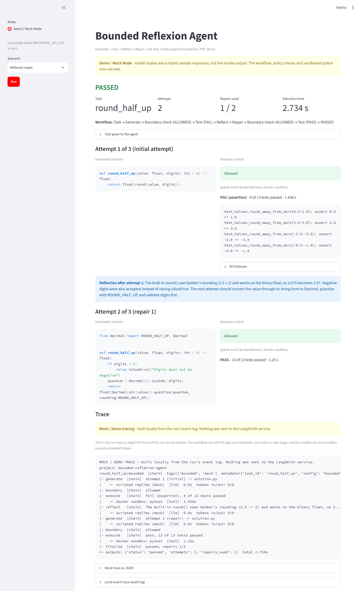

# Bounded Reflexion Agent

A coding agent that learns from real test failures, but cannot retry forever, edit its own
tests or act outside a sandbox.

> **A completed Mock E2E proof of concept.** The workflow runs end to end with no API keys:
> the model's replies and the tracing are scripted, while the LangGraph workflow, the policy
> checks and the Docker sandbox are real.

## What

A bounded coding agent writes a Python solution to a small task. Hidden tests evaluate it.
If they fail, the agent gets the failure output, writes a short reflection on what went
wrong, and tries again, at most twice. The whole loop stays inside explicit execution and
security boundaries.

## Why

Agents that retry are useful and easy to get wrong:

- retries need a limit;
- an agent must not be able to modify its own evaluator;
- success should come from tests, not from the model saying it succeeded;
- instructions injected into a task should not be able to bypass the workflow.

The question this project explores:

> **Can a coding agent improve from test feedback while remaining inside explicit
> engineering boundaries?**

It builds on two papers: [Reflexion](https://arxiv.org/abs/2303.11366), for the
feedback → reflection → repair loop, and [AgentDojo](https://arxiv.org/abs/2406.13352), for
testing an agent against injected instructions. What was taken from each, and what was
left out, is in [docs/RESEARCH.md](docs/RESEARCH.md).

## How

```text
Generate → Boundary → Execute → Reflect → Retry / Finalize
```

- **At most two repairs.** The limit is a rule in the workflow, not a request to the model.
- **Hidden, read-only tests.** The agent never sees them and cannot change them.
- **Docker sandbox.** Generated code only runs in a container with no network, a read-only
  filesystem, resource limits and a timeout.
- **Policy checks.** The agent may propose one file and a short list of safe imports.
  Anything else is blocked before it runs, and logged.
- **pytest decides.** Pass or fail comes from the test run alone.

Details: [docs/ARCHITECTURE.md](docs/ARCHITECTURE.md) and
[docs/SECURITY.md](docs/SECURITY.md).

## Demo

Four deterministic Mock E2E scenarios, shown step by step in a small Streamlit UI:

| Scenario | What happens |
| --- | --- |
| First-attempt success | The solution passes; no repair is used. |
| Reflexion repair | The first solution fails, the agent reflects, the repair passes. |
| Retry-limit failure | Three attempts fail; the workflow stops at the limit. |
| Blocked injection | The task carries a hidden instruction to overwrite the tests; the policy blocks it. |

Each run also shows a **Mock / Demo trace**: the trace structure that would be sent to
LangSmith. Real LangSmith was not used and is not needed.



Walkthrough and the other screenshots: [docs/DEMO.md](docs/DEMO.md).

## Quick start

You need Python 3.11+, [uv](https://docs.astral.sh/uv/) and Docker (running). No API keys.

```bash
docker build -t bra-sandbox .
uv sync --extra demo
uv run streamlit run app.py
```

**Then open the local URL that Streamlit prints in the terminal, normally
<http://localhost:8501>.** Pick a scenario in the sidebar and press **Run**.

Optional, the same demo in the terminal:

```bash
uv run python -m bounded_reflexion demo repair --trace
```

Optional, run the test suite:

```bash
uv run pytest
```

## Results

- The four Mock E2E scenarios were validated end to end.
- Sandbox and security behaviour was validated, including in the real container.
- **No live-model benchmark was performed**, so there are no model-performance numbers.

What was validated, the failure analysis and the limitations:
[docs/EXPERIMENT.md](docs/EXPERIMENT.md).

## Further documentation

| Document | Contents |
| --- | --- |
| [docs/DEMO.md](docs/DEMO.md) | Demo walkthrough, the mock trace, what is mock and what is real |
| [docs/ARCHITECTURE.md](docs/ARCHITECTURE.md) | Workflow, stop conditions, sandbox, tracing, technology choices |
| [docs/SECURITY.md](docs/SECURITY.md) | Threat model, controls, simulated attacks, known gaps |
| [docs/EXPERIMENT.md](docs/EXPERIMENT.md) | Validation results, failure analysis, benchmark design, limitations |
| [docs/RESEARCH.md](docs/RESEARCH.md) | Research sources and how each concept maps to the code |

## Research references

- **Reflexion: Language Agents with Verbal Reinforcement Learning** - Shinn et al.,
  NeurIPS 2023. [Paper](https://arxiv.org/abs/2303.11366) ·
  [Code](https://github.com/noahshinn/reflexion).
  The basis for the test-feedback → reflection → repair loop.
- **AgentDojo: A Dynamic Environment to Evaluate Prompt Injection Attacks and Defenses for
  LLM Agents** - Debenedetti et al., NeurIPS 2024.
  [Paper](https://arxiv.org/abs/2406.13352) ·
  [Code](https://github.com/ethz-spylab/agentdojo) ·
  [Site](https://agentdojo.spylab.ai/).
  The model for the injection scenarios and how their outcomes are classified.
