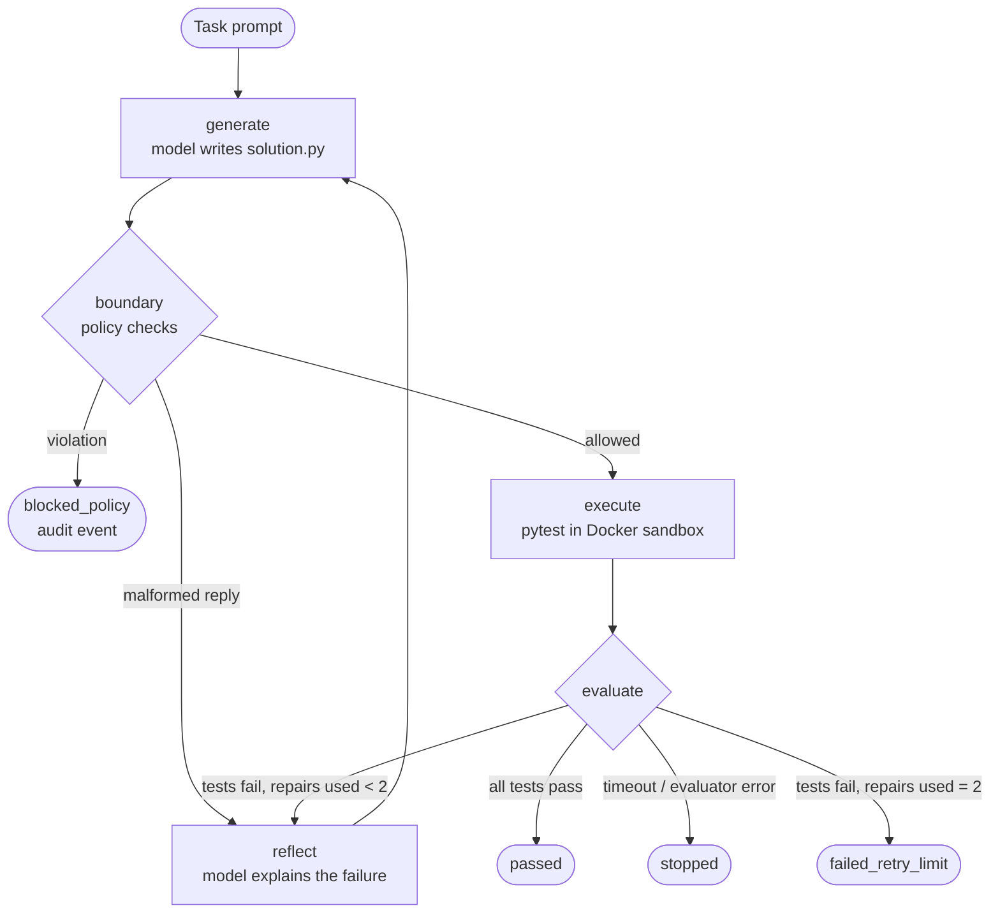

# Architecture

This describes the repository as built. The workflow, policies and sandbox are tested
locally and demonstrated end to end with scripted model replies. The real model and
LangSmith integrations are present as boundaries and were not exercised against the live
services (see [Provider boundaries](#provider-boundaries)).

## Workflow



One LangGraph `StateGraph` with five nodes (`graph.py`). One model plays two roles through
two prompts: writing code (`generate`) and explaining a failure (`reflect`). There is no
agent-to-agent communication and no tool calling: the model's only output is a *proposal*,
a set of `<file path="...">` blocks, which the workflow accepts or rejects.

| Node | Responsibility |
|---|---|
| `generate` | Call the model. First attempt: task only. Repairs: task, previous code, test feedback and all reflections so far. |
| `boundary` | In the bounded configuration, run the policy checks on the proposal. Record the decision as an audit event. |
| `execute` | Write the proposal into a throwaway workspace, run the protected tests in Docker, parse the report, verify the tests did not change. |
| `reflect` | Call the model for a short verbal diagnosis; append it to `reflections`. |
| `finalize` | Set the final status. |

## Stop conditions

Every stop is a routing decision in `graph.py`, not a prompt instruction.

| Final status | Trigger |
|---|---|
| `passed` | All protected tests pass. |
| `failed` | Tests fail and the configuration allows no repairs (single attempt). |
| `failed_retry_limit` | Tests fail (or output is malformed) after the initial attempt plus 2 repairs. |
| `blocked_policy` | The policy layer rejected the proposal. Nothing was executed. |
| `timeout` | The sandbox exceeded its time limit. No repair is attempted. |
| `evaluator_error` | No trustworthy verdict: sandbox failure, missing or rejected report, or the protected tests changed. Fails closed. |

The retry bound is `repair_or_stop`: a repair is allowed only while
`attempt - 1 < max_repairs`. `MAX_REPAIRS = 2` is a constant in `state.py`, and `RunConfig`
refuses a larger value, so no configuration can raise it.

## Three zones

| Zone | Location | Who can write |
|---|---|---|
| Agent workspace | A temporary directory created per attempt and deleted afterwards | The controller, on the model's behalf, and only inside that directory |
| Protected evaluation | `tests/evaluation/<task>/` | Humans only. Mounted read-only into the sandbox; never included in a prompt. |
| Control code | `src/bounded_reflexion/` | Humans only. Never mounted into the sandbox. |

How the evaluation boundary is enforced, in layers:

1. **No capability.** The model has no tools. It cannot run a command or touch a file; it
   can only return text.
2. **Workspace confinement** (always on). `resolve_in_workspace` rejects absolute paths,
   drive letters and `..`; such files are skipped and logged. A proposed file named
   `tests/evaluation/x/test_solution.py` therefore lands in the temporary workspace, not in
   the repository.
3. **Write allowlist** (bounded configuration). Only `solution.py` may be proposed. Anything
   else stops the run before execution.
4. **Read-only mounts.** Inside the container the tests (`/eval`), the solution
   (`/workspace`) and the root filesystem are read-only.
5. **Integrity check.** A SHA-256 digest of the task's test directory is compared before
   and after every execution. A mismatch ends the run as `evaluator_error`.
6. **Verdict from the evaluator only.** Pass or fail is derived from the pytest exit code
   and JUnit report. Model text is never consulted.

## Sandbox

`runner.py` builds one fixed `docker run` command. Nothing produced by the model is
interpolated into the command line.

| Control | Setting |
|---|---|
| Network | `--network none` |
| Filesystem | `--read-only` root, read-only mounts for tests and solution |
| Writable paths | `/tmp` (16 MB tmpfs) and `/out` (the JUnit report) |
| Memory / CPU / processes | `--memory 256m --memory-swap 256m`, `--cpus 1`, `--pids-limit 64` |
| Privileges | non-root user, `--cap-drop ALL`, `--security-opt no-new-privileges` |
| Time | wall-clock timeout (default 20 s), then `docker kill` |
| Image | `python:3.12-slim` plus pytest. No project code, no credentials. |

## Observability

Each node appends an event to the run's event log: the stage, the attempt number, policy
decisions and violations, the sandbox verdict, the reflection text, model-call latency and
token usage, and the final outcome. Everything else is rendered from that log.

| Output | Source | Status |
|---|---|---|
| CLI trace and UI panels | Event log | Tested locally, shown in the demo |
| **Mock / Demo trace** (`tracing.build_mock_trace`) | Event log, arranged as the run tree LangSmith would receive: a root run with name, tags and metadata, one child run per stage, model calls and sandbox runs beneath | Tested locally, shown in the demo. Built locally; nothing is sent. |
| Real LangSmith trace | LangGraph's built-in tracing when `LANGSMITH_TRACING=true`; the record then carries the trace URL | Designed, not validated against a live account |

The mock trace and the real integration take the run name, tags and metadata from the same
function (`tracing.run_identity`), so the mock shows what would be sent. Mock runs disable
external tracing explicitly, so a demo never reports to LangSmith even when tracing
variables are set.

## Provider boundaries

| Boundary | Real implementation | Used in Mock E2E | Validated live |
|---|---|---|---|
| Model | `agent.make_model` (Anthropic chat model through LangChain) | A scripted chat model replaying stored replies (`demo.py`) | No |
| Tracing | LangGraph to LangSmith, URL lookup in `tracing.langsmith_url` | `tracing.build_mock_trace` | No |
| Code execution | Docker sandbox (`runner.py`) | The same Docker sandbox | Yes, locally |

The workflow depends only on the chat-model interface (`invoke` on a list of messages), so
the scripted model and the real one are interchangeable without changing the graph.

## Modules

| File | Purpose |
|---|---|
| `state.py` | `RunState`, `RunConfig`, `MAX_REPAIRS`, task loading |
| `agent.py` | Prompts, the model factory, reply parsing |
| `policies.py` | Write allowlist, static code policy, workspace confinement, test digest |
| `runner.py` | Docker sandbox |
| `evaluator.py` | JUnit report to structured feedback |
| `graph.py` | The workflow and `run_task` |
| `attacks.py` | Injection cases and outcome classification |
| `metrics.py` | Aggregation of run records |
| `tracing.py` | Run identity, the Mock / Demo trace, the LangSmith URL lookup |
| `demo.py` | Mock scenarios with scripted model replies |
| `__main__.py` | CLI |

## Technology

| Tool | Why it is here |
|---|---|
| LangGraph | The workflow is a state machine with explicit stop conditions; that is the thing being demonstrated. |
| LangChain (core + Anthropic integration) | The chat-model interface, and the scripted model used by the demo and tests. Nothing else. |
| LangSmith | The tracing target the workflow is designed for. Represented by the local mock trace; the real service was not used. |
| pytest | The evaluator, and the project's own test suite. |
| Docker | The execution boundary for generated code. |
| Streamlit | The demo UI (optional extra). |

## Repository layout

```text
src/bounded_reflexion/   workflow, agent, policies, sandbox runner, evaluator, metrics, tracing
tasks/                   task prompts given to the agent
tests/evaluation/        protected evaluator tests (run only inside the sandbox)
tests/reference/         reference solutions proving each task is solvable
tests/unit/              the project's deterministic test suite
experiments/             live benchmark runner (implemented, not executed)
app.py                   Streamlit demo UI
Dockerfile               sandbox image
```
